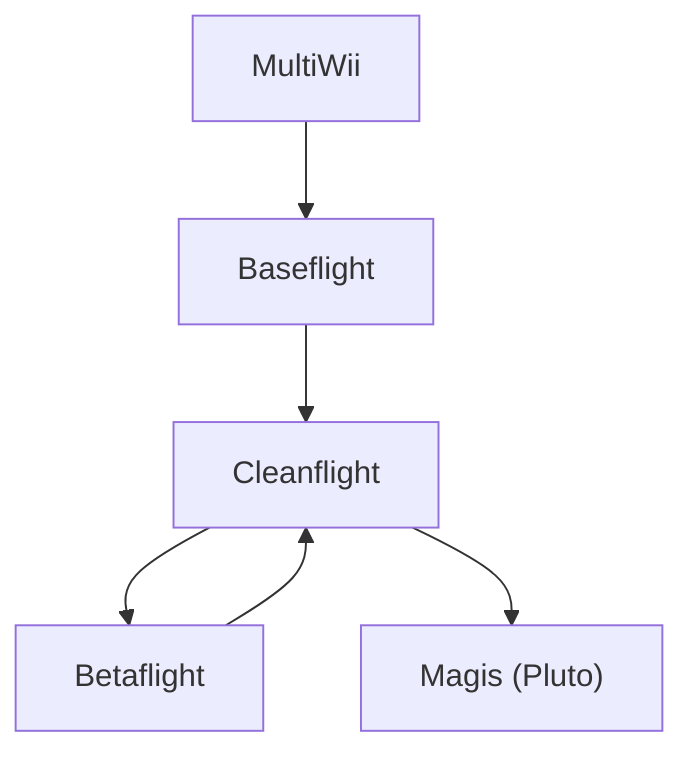

# JUST Drones Ablation Notes

## Target Drone: Pluto

- Firmware: Drone.bin
- Architecture: ARM Cortex-M3 32bit
- MCU: STM32F103RB
- OS/Sys lib: Bare Metal
- Source code: Custom Flight Controller Firmware for Quadcopters provided by a CMU Graduate [link](https://github.com/heethesh/eYSIP-2017_Control_and_Algorithms_development_for_Quadcopter)
- Product: Pluto Drone provided by Drona Aviation [link](https://www.dronaaviation.com/)

## Firmware Background

### Pluto Flight Controller Software
https://github.com/DronaAviation/Magis 

Magis is forked from Cleanflight

Origins for this fork (Thanks!):
- Alexinparis (for MultiWii),
- timecop (for Baseflight),
- Dominic Clifton (for Cleanflight)

https://github.com/multiwii/baseflight

Baseflight is a 32 bit fork of the MultiWii RC flight controller firmware

https://github.com/cleanflight/cleanflight

Clean-code version of the baseflight flight controller firmware

Cleanflight is forked from Baseflight, Cleanflight was forked by Betaflight, Cleanflight is again forked from Betaflight.

### Firmware Lineage


## Training Data

### Firmware Families
| Firmware | Size |  Source | Similar to Target (Pluto) |
| -------- | ---- | ------ | ---------------- |
| Magis       | Small  | https://github.com/DronaAviation/Magis/releases     | Reference |
| Cleanflight | Medium | https://github.com/cleanflight/cleanflight/releases | Very High |
| Betaflight  | Large  | https://github.com/betaflight/betaflight/releases   | High      |

Using only the STM32F1 targets to match the MCU of the Drone of Interest

### Observed Extracted Data

The extracted training set contains 15 STM32F1 firmware binaries:

| Category | Number of binaries |
| -------- | ------------------ |
| Betaflight | 5 |
| Cleanflight | 5 |
| Magis | 5 |

The extraction script preserves these category directories under
`training_data/extraction/` and writes each converted image to
`<category>/<firmware>/<firmware>.bin`.

All extracted binaries are 131,072 bytes (128 KiB), matching the configured
flash-size output. This includes `0xFF` padding. The non-padding firmware
payloads range from approximately 59,920 to 128,382 bytes, so the full output
files should not be treated as equally populated firmware images. All 15 files
have distinct SHA-256 hashes; none are duplicate binaries.

#### Corruption Severity Caveat

Partial-dump and partial-write severities are calculated against the complete
128 KiB flash image. For binaries with a shorter payload, a large selected
range can therefore affect only unused `0xFF` flash. Such a corruption has no
effect on the real firmware payload and can produce static-analysis curves
that are unchanged from the uncorrupted, no-repair, and oracle-donor cases.
Interpret those results as an uninformative corruption case rather than a
perfect repair. To evaluate these modes meaningfully, select ranges that
intersect non-padding firmware bytes, or trim unused flash before corruption.

The category relationship is therefore based on firmware lineage and target
hardware, not binary identity. Magis is the reference family for the Pluto
target, Cleanflight is its closer ancestor, and Betaflight is the related
cousin family used for the cross-family ablation.

## Dataset Extraction

Uses Dataset+Metadata.csv for target hardware flash size and base address
```bash
bash training_data/run_converter_all.sh
```

## Autoencoder Repair Pipeline

Repair-correctness aggregation treats each experiment directory as a separate
technique. The resulting labels are `E0_baseline_autoencoder_fill`,
`E1_magis_reference_autoencoder_fill`,
`E2_cleanflight_ancestor_autoencoder_fill`, and
`E3_betaflight_cousin_autoencoder_fill`.

* `train_autoencoder.py` — trains a denoising byte autoencoder on a folder with
	binaries and saves the trained weights.
* `autoencoder_fill.py` — loads a trained model and ranks candidate bytes for
	each corrupted index using sliding-window reconstruction with overlap and
	soft-vote majority.

### 1. Train the Model

```bash
python3 train_autoencoder.py <data_folder> <model_output.pt> \
	[--seq-len 64] [--stride 16] [--epochs 40] [--batch-size 64] \
	[--corruption-rate 0.15] [--embedding-dim 16] [--latent-dim 128] [--lr 1e-3]
```

The trainer walks every file directly under `<data_folder>`, slides a window
of `--seq-len` bytes with the given `--stride`, and treats every window as a
training sample. During each step, `--corruption-rate` of the bytes in the
input are replaced with uniformly random values while the original bytes
remain the reconstruction target. `--stride` defaults to `--seq-len`
(non-overlapping windows); a smaller stride yields more training samples per
file. The saved `.pt` file contains both the trained weights and the model
configuration (`seq_len`, `embedding_dim`, `latent_dim`), so the repair
script can rebuild the exact architecture.

```bash
python3 train_autoencoder.py training_data/extraction/Betaflight models/autoencoder_betaflight.pt 
python3 train_autoencoder.py training_data/extraction/Cleanflight models/autoencoder_cleanflight.pt
python3 train_autoencoder.py training_data/extraction/Magis models/autoencoder_magis.pt
```

### 2. Repair a Corrupted Binary

```bash
python3 autoencoder_fill.py <indexes.csv> <corrupted.bin> <model.pt> \
	<output_folder> [--stride N] [--top-k 5] [--batch-size 128]
```

The repair script slides `seq_len`-byte windows across the corrupted binary
(with `--stride` defaulting to `seq_len // 4`, i.e. roughly four windows per
byte). Every window is fed through the autoencoder, and the resulting
softmax distributions are averaged across all windows that cover a given
position — a soft-vote majority across overlapping reconstructions. For each
index listed in the input CSV, the top `--top-k` bytes from that averaged
distribution are written as ranked candidates.

#### Repair Output

The output file is named `<stem>.autoencoder_fill.repair.csv` and has one row
per (index, rank) pair:

| column           | meaning                                                     |
| ---------------- | ----------------------------------------------------------- |
| `index`          | byte offset in the corrupted binary                         |
| `corrupted_byte` | value currently at that offset (`-1` if out of bounds)      |
| `rank`           | 1-based rank of the candidate (1 is the model's top pick)   |
| `candidate_byte` | predicted replacement byte in `0..255`                      |
| `score`          | averaged softmax probability for that byte across windows   |
| `windows`        | number of overlapping windows that voted on this index      |

Indexes that fall outside the binary, or that no window can cover (only
possible when the binary is shorter than `seq_len`), are emitted once with
`candidate_byte = -1` and `windows = 0`.

Example — repair the drone bit-flip test binary with a model trained above:

#### Tuning Notes

* **`--seq-len`** must match between training and inference (the repair
	script reads it from the checkpoint).
* **`--stride` at inference** trades runtime for redundancy. Smaller strides
	give more overlapping votes per byte (and stronger majority signals) but
	require more forward passes.
* **`--top-k`** only affects the number of rows in the output; the ranking is
	computed over all 256 possible bytes regardless.


## Autoencoder Experiments
- E0: Baseline Model
    * Repair corrupted Pluto/Magis firmware with the default, general-purpose
      model shipped in `src/repair/denoising_autoencoder/models/autoencoder.pt`
      (not trained on any drone-related firmware family).

- E1: Reference Firmware Training
    * Train on Pluto/Magis firmware and repair corrupted Pluto/Magis firmware.

- E2: Ancestor Firmware Training
    * Train on Cleanflight firmware and repair corrupted Pluto/Magis firmware.

- E3: Cousin Firmware Training
    * Train on Betaflight firmware and repair corrupted Pluto/Magis firmware.

## Running the Repair Experiments

Each experiment repairs every corrupted binary under `dataset/Drone-Corrupted`
with a model trained on a different firmware family, using the shared
`run_repair_autoencoder_all.sh` wrapper from the main repo's `scripts/`
folder. Paths below are relative to the repo root (`firmmend`), so run these
commands from that directory (or adjust the paths accordingly).

```bash
# Train a model per family (skip if the .pt file already exists in models/)
python3 drone_ablation/train_autoencoder.py \
	drone_ablation/training_data/extraction/Magis \
	drone_ablation/models/autoencoder_magis.pt
python3 drone_ablation/train_autoencoder.py \
	drone_ablation/training_data/extraction/Cleanflight \
	drone_ablation/models/autoencoder_cleanflight.pt
python3 drone_ablation/train_autoencoder.py \
	drone_ablation/training_data/extraction/Betaflight \
	drone_ablation/models/autoencoder_betaflight.pt

# E0: Baseline — default model, not trained on any drone-related firmware
./scripts/run_repair_autoencoder_all.sh \
	drone_ablation/dataset/Drone-Corrupted \
	drone_ablation/repairs/E0_baseline

# E1: Reference (Magis) — repair every corrupted Drone binary
./scripts/run_repair_autoencoder_all.sh \
	--model drone_ablation/models/autoencoder_magis.pt \
	drone_ablation/dataset/Drone-Corrupted \
	drone_ablation/repairs/E1_magis_reference

# E2: Ancestor (Cleanflight)
./scripts/run_repair_autoencoder_all.sh \
	--model drone_ablation/models/autoencoder_cleanflight.pt \
	drone_ablation/dataset/Drone-Corrupted \
	drone_ablation/repairs/E2_cleanflight_ancestor

# E3: Cousin (Betaflight)
./scripts/run_repair_autoencoder_all.sh \
	--model drone_ablation/models/autoencoder_betaflight.pt \
	drone_ablation/dataset/Drone-Corrupted \
	drone_ablation/repairs/E3_betaflight_cousin
```

`--model` is omitted for E0 so `run_repair_autoencoder.sh` falls back to its
default, `src/repair/denoising_autoencoder/models/autoencoder.pt`.

Each run writes mended binaries and repair CSVs under
`drone_ablation/repairs/<experiment>/autoencoder_fill/...`, mirroring
the `dataset/Drone-Corrupted` layout.

## Repairing the Baselines (no_repair / oracle_donor)

Every experiment is compared against the same two baselines: the unrepaired
corrupted binary (`no_repair`) and the oracle upper bound that copies the
true byte from the uncorrupted original (`oracle_donor`). These use the
generic `run_repair_all.sh` wrapper instead of the autoencoder one, and only
need to be produced once for all E0–E3 comparisons.

```bash
./scripts/run_repair_all.sh --method no_repair \
	drone_ablation/dataset/Drone-Corrupted \
	drone_ablation/repairs

./scripts/run_repair_all.sh --method oracle_donor \
	--original-root drone_ablation/dataset/Drone-Original \
	drone_ablation/dataset/Drone-Corrupted \
	drone_ablation/repairs
```

This writes `drone_ablation/repairs/no_repair/...` and
`drone_ablation/repairs/oracle_donor/...`, matching each corrupted
binary in `Drone-Corrupted` to `Drone.bin` under `Drone-Original`.

```bash
./scripts/eval/static/run_angr_all.sh drone_ablation/repairs drone_ablation/results
./scripts/eval/static/run_ghidra_all.sh drone_ablation/repairs drone_ablation/results
./scripts/eval/static/run_aggregate.sh drone_ablation/results drone_ablation/figures
```

`run_angr_all.sh`/`run_ghidra_all.sh` walk every method folder under
`drone_ablation/repairs` (including `no_repair` and `oracle_donor`), and
`run_aggregate.sh` writes one `static_results_macro_average.csv` per method
under `drone_ablation/figures/<method>/`.

## Running Static Evaluation

Static evaluation (angr and Ghidra) and aggregation reuse the same
`scripts/eval/static` tooling used for the main experiments, pointed at each
experiment's repair output:

```bash
# E0
./scripts/eval/static/run_angr_all.sh \
	drone_ablation/repairs/E0_baseline \
	drone_ablation/results/E0_baseline
./scripts/eval/static/run_ghidra_all.sh \
	drone_ablation/repairs/E0_baseline \
	drone_ablation/results/E0_baseline
./scripts/eval/static/run_aggregate.sh \
	drone_ablation/results/E0_baseline \
	drone_ablation/figures/E0_baseline
./scripts/eval/static/create_figures.sh \
	drone_ablation/figures/E0_baseline/static_results_macro_average.csv \
	drone_ablation/figures/E0_baseline
./scripts/eval/static/create_figures_compare.sh \
	drone_ablation/figures/oracle_donor/static_results_macro_average.csv \
	drone_ablation/figures/no_repair/static_results_macro_average.csv \
	drone_ablation/figures/E0_baseline/static_results_macro_average.csv \
	drone_ablation/figures/E0_baseline/compare

# E1
./scripts/eval/static/run_angr_all.sh \
	drone_ablation/repairs/E1_magis_reference \
	drone_ablation/results/E1_magis_reference
./scripts/eval/static/run_ghidra_all.sh \
	drone_ablation/repairs/E1_magis_reference \
	drone_ablation/results/E1_magis_reference
./scripts/eval/static/run_aggregate.sh \
	drone_ablation/results/E1_magis_reference \
	drone_ablation/figures/E1_magis_reference
./scripts/eval/static/create_figures.sh \
	drone_ablation/figures/E1_magis_reference/static_results_macro_average.csv \
	drone_ablation/figures/E1_magis_reference
./scripts/eval/static/create_figures_compare.sh \
	drone_ablation/figures/oracle_donor/static_results_macro_average.csv \
	drone_ablation/figures/no_repair/static_results_macro_average.csv \
	drone_ablation/figures/E1_magis_reference/static_results_macro_average.csv \
	drone_ablation/figures/E1_magis_reference/compare

# E2
./scripts/eval/static/run_angr_all.sh \
	drone_ablation/repairs/E2_cleanflight_ancestor \
	drone_ablation/results/E2_cleanflight_ancestor
./scripts/eval/static/run_ghidra_all.sh \
	drone_ablation/repairs/E2_cleanflight_ancestor \
	drone_ablation/results/E2_cleanflight_ancestor
./scripts/eval/static/run_aggregate.sh \
	drone_ablation/results/E2_cleanflight_ancestor \
	drone_ablation/figures/E2_cleanflight_ancestor
./scripts/eval/static/create_figures.sh \
	drone_ablation/figures/E2_cleanflight_ancestor/static_results_macro_average.csv \
	drone_ablation/figures/E2_cleanflight_ancestor
./scripts/eval/static/create_figures_compare.sh \
	drone_ablation/figures/oracle_donor/static_results_macro_average.csv \
	drone_ablation/figures/no_repair/static_results_macro_average.csv \
	drone_ablation/figures/E2_cleanflight_ancestor/static_results_macro_average.csv \
	drone_ablation/figures/E2_cleanflight_ancestor/compare

# E3
./scripts/eval/static/run_angr_all.sh \
	drone_ablation/repairs/E3_betaflight_cousin \
	drone_ablation/results/E3_betaflight_cousin
./scripts/eval/static/run_ghidra_all.sh \
	drone_ablation/repairs/E3_betaflight_cousin \
	drone_ablation/results/E3_betaflight_cousin
./scripts/eval/static/run_aggregate.sh \
	drone_ablation/results/E3_betaflight_cousin \
	drone_ablation/figures/E3_betaflight_cousin
./scripts/eval/static/create_figures.sh \
	drone_ablation/figures/E3_betaflight_cousin/static_results_macro_average.csv \
	drone_ablation/figures/E3_betaflight_cousin
./scripts/eval/static/create_figures_compare.sh \
	drone_ablation/figures/oracle_donor/static_results_macro_average.csv \
	drone_ablation/figures/no_repair/static_results_macro_average.csv \
	drone_ablation/figures/E3_betaflight_cousin/static_results_macro_average.csv \
	drone_ablation/figures/E3_betaflight_cousin/compare
```

Each `create_figures_compare.sh` call writes
`static_results_auc_compare.csv` (trapezoidal AUC per corruption mode,
normalized by the oracle-donor AUC) under the experiment's `compare/` folder.

`run_angr.sh`/`run_ghidra.sh` run inside Docker containers (`firmcorr-angr`,
`firmcorr-ghidra`); build those images per the main repo's `Dockerfile.angr`
and `Dockerfile.ghidra` before running the `_all` wrappers above.

## Comparing All Experiments

Once every experiment's `static_results_auc_compare.csv` exists, overlay them
in a single AUC figure with `create_figures_auc.sh`:

```bash
./scripts/eval/static/create_figures_auc.sh drone_ablation/figures/auc_compare \
	drone_ablation/figures/E0_baseline/compare/static_results_auc_compare.csv \
	drone_ablation/figures/E1_magis_reference/compare/static_results_auc_compare.csv \
	drone_ablation/figures/E2_cleanflight_ancestor/compare/static_results_auc_compare.csv \
	drone_ablation/figures/E3_betaflight_cousin/compare/static_results_auc_compare.csv \
	--labels "E0 Baseline" "E1 Magis" "E2 Cleanflight" "E3 Betaflight"
```

```bash
./scripts/run_manifest_all.sh \
  drone_ablation/repairs/no_repair \
  drone_ablation/dataset/Drone-Corrupted \
  drone_ablation/dataset/Drone-Original

./scripts/run_manifest_all.sh \
  drone_ablation/repairs/E0_baseline/autoencoder_fill \
  drone_ablation/dataset/Drone-Corrupted \
  drone_ablation/dataset/Drone-Original

./scripts/run_manifest_all.sh \
  drone_ablation/repairs/E1_magis_reference/autoencoder_fill \
  drone_ablation/dataset/Drone-Corrupted \
  drone_ablation/dataset/Drone-Original

./scripts/run_manifest_all.sh \
  drone_ablation/repairs/E2_cleanflight_ancestor/autoencoder_fill \
  drone_ablation/dataset/Drone-Corrupted \
  drone_ablation/dataset/Drone-Original

./scripts/run_manifest_all.sh \
  drone_ablation/repairs/E3_betaflight_cousin/autoencoder_fill \
  drone_ablation/dataset/Drone-Corrupted \
  drone_ablation/dataset/Drone-Original

./scripts/run_manifest_all.sh \
  drone_ablation/repairs/oracle_donor \
  drone_ablation/dataset/Drone-Corrupted \
  drone_ablation/dataset/Drone-Original

./scripts/eval/create_repair_correctness_figures.sh \
  drone_ablation/repairs \
  drone_ablation/figures/repair_correctness
```
