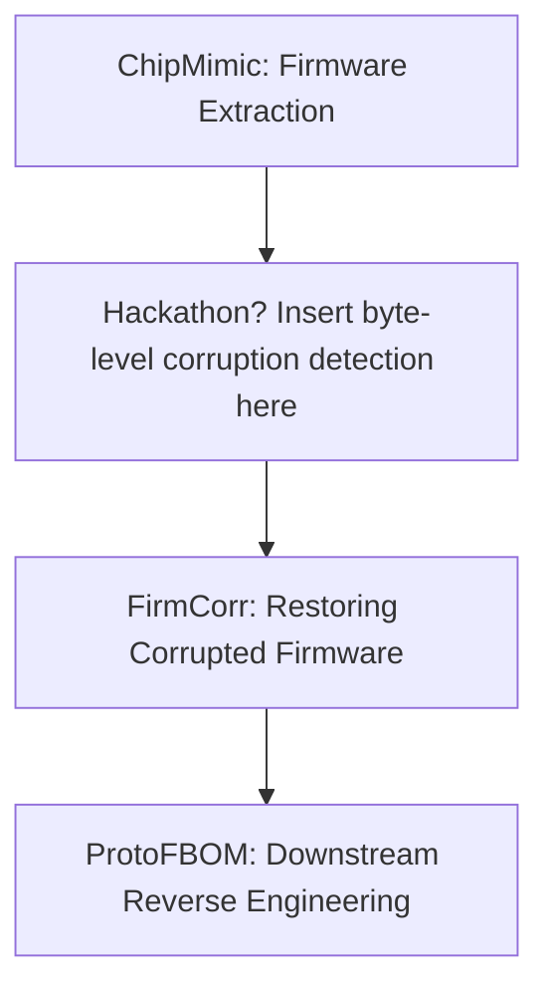

# Example Dataset, Files, and Tests
See FIRMCORR for test corrupted binaries and evaluation methodology

# How do you envision your tool to be integrated into FIRE process?
We envision this tool to be downstream of firmware extraction and firmware corruption detection. This is Proof of Concept (POC) tool that provides some repair strategies to rewrite corrupted binaries given the indexes of corrupted bytes, enabling more resilient reverse engineering and vulnerability analysis.

# Block diagram showing workflow(s) on how your tool can be used and integrated with other tools

